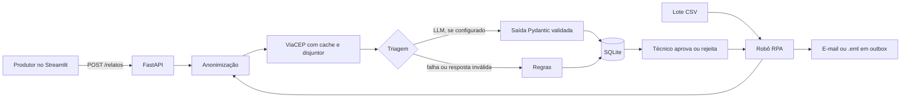

# CampoConecta (CitizenTech): relatos do pequeno produtor rural

Protótipo da Global Solution 2026.2 (FIAP). O pequeno produtor relata um problema do campo (praga, clima extremo, falta de água, preço ruim, dificuldade com crédito ou seguro), a IA classifica o tipo e a urgência, uma pessoa da assistência técnica confere e um robô consolida os casos aprovados em um e-mail para o órgão ou a cooperativa responsável.

> **Integrantes:** Pedro Leal Murad — RM565460; Murilo Benhossi — RM562358; Nicolas Lemos Ribeiro — RM553273.
> **Repositório público:** publicação pendente de autenticação no GitHub.
> **Vídeos de Front e RPA:** gravações locais prontas ([Front](docs/videos/front.mp4) e [RPA](docs/videos/rpa.mp4)); links públicos pendentes, um vídeo por disciplina.
> **Execução:** Docker local validado; não há deploy público confirmado.

Prazo informado pelo grupo: **19/11/2026 às 23h55**; meta interna: **18/11/2026**. A conferência dos campos e regras de envio no Portal do Aluno ainda está pendente.
O mapa completo de exigências por matéria está em [`docs/REQUISITOS.md`](docs/REQUISITOS.md).

## 1. Problema e público

> Rascunho para o grupo revisar e reescrever com as próprias palavras.

**Público afetado:** pequenos produtores e agricultores familiares, e as equipes de assistência técnica, cooperativas e secretarias de agricultura que os atendem.

**Fatos que sustentam o problema:**

- A agricultura familiar responde por cerca de 77% dos estabelecimentos agropecuários do país (cerca de 3,9 milhões), mas só 15,4% deles têm acesso a crédito rural, segundo levantamento do WRI Brasil com base no Censo Agropecuário de 2017 (PARAÍBA BUSINESS, 2026).
- No ano agrícola 2024/25, cerca de 21% dos agricultores familiares acessaram o Pronaf, ou seja, quase 4 em cada 5 ficaram de fora. Entre as barreiras estão burocracia, exigência de garantias, baixa oferta de assistência técnica e de seguro rural. O Plano Safra 2025/26 previu R$ 240 milhões para assistência técnica, menos de 0,3% dos R$ 89 bilhões destinados à agricultura familiar (SOUZA, 2026).

**Limites dessas fontes:** elas mostram a distância entre o pequeno produtor e o crédito, o seguro e a assistência técnica, mas não medem quantos relatos de problema chegam à assistência técnica nem quanto tempo se perde para priorizá-los. Essa dor (triagem e encaminhamento de relatos) é uma **hipótese do grupo**. Para sustentá-la, buscar dados de atendimento da extensão rural do município ou conversar com as 3 pessoas do teste de validação (por exemplo, um técnico de extensão e dois produtores).

**ODS relacionados à proposta:** 2 (fome zero e agricultura sustentável), 1 (erradicação da pobreza) e 13 (ação contra a mudança do clima).

**Referências**

PARAÍBA BUSINESS. **Agricultura familiar tem 77% das propriedades, mas só 15,4% acessam crédito, diz WRI.** 15 out. 2026. Disponível em: https://paraibabusiness.com.br/agricultura-familiar-tem-77-das-propriedades-mas-so-154-acessam-credito-diz-wri/.

SOUZA, Priscila. **Quem mais precisa, menos acessa: recomendações para um Pronaf inclusivo e sustentável.** Climate Policy Initiative/PUC-Rio, 25 maio 2026. Disponível em: https://www.climatepolicyinitiative.org/pt-br/publication/quem-mais-precisa-menos-acessa-recomendacoes-para-um-pronaf-inclusivo-e-sustentavel/.

## 2. Fluxo ponta a ponta



1. **Entrada:** texto e CEP opcional, validados no front e de novo no back-end com Pydantic.
2. **Processamento:** o front nunca chama o LLM. O back-end anonimiza o texto, consulta o CEP e classifica. O texto original não é gravado.
3. **Resposta:** cartão com urgência (cor, ícone e texto), tipo, encaminhamento sugerido e aviso quando um caso será conferido por uma pessoa. O produtor avalia se a classificação ajudou.
4. **Ação:** o gestor aprova ou rejeita. O robô monta o e-mail só com os casos aprovados, usando o texto tratado. A anonimização tem limitações; consulte a seção 7.

## 3. Como rodar

Python 3.12 ou superior.

```bash
cp .env.example .env                       # preencha o que quiser; tudo é opcional para a demonstração
pip install -r backend/requirements.txt -r frontend/requirements.txt
python data/gerar_dados.py                 # gera os dados sintéticos (já incluídos)

# terminal 1: API
cd backend && uvicorn app.main:app --port 8000
# terminal 2: interface
cd frontend && streamlit run app.py

# robô em lote (ponto de entrada do RPA)
cd backend && python rpa_run.py            # ou: python rpa_run.py caminho/outro.csv

# testes e medição
cd backend && pytest -q && python avaliar.py
cd frontend && pytest -q
```

Com Docker: `docker compose up --build` (API em `localhost:8000`, interface em `localhost:8501`). O build e as verificações de saúde dos dois serviços foram concluídos em **10/11/2026**. O teste do fluxo pela API em Docker foi registrado; a validação pela tela e seus limites estão no [relatório de execução](docs/validacao/RELATORIO_EXECUCAO.md).

Sem chave de LLM, a triagem usa regras. Para usar o LLM, preencha `GEMINI_API_KEY` e `GEMINI_MODEL` no `.env` (o nome do modelo não é fixado no código porque os modelos mudam).

## 4. RPA: quadro de temas

| Tema da disciplina | Onde é usado | O que resolve |
|---|---|---|
| Pandas | `pipelines/rpa/limpeza.py` | Lê o CSV, remove duplicados, rejeita linhas inválidas com o motivo, normaliza data e CEP |
| Integração com API | `providers/viacep.py` | Descobre cidade e UF pelo CEP do sítio ou da sede do município, com timeout, retry com espera, cache e disjuntor |
| Banco SQL | `providers/db.py` | Grava os relatos em SQLite de forma idempotente |
| E-mail automatizado | `pipelines/rpa/relatorio_email.py` | Monta o alerta em texto e HTML; envia por SMTP ou salva em `outbox/` |

Resiliência do robô: uma linha ruim não derruba o lote; arquivo ausente ou sem colunas encerra com status `falha` e mensagem, sem exceção; tudo vai para `logs/robo.log`; linhas rejeitadas vão para `outbox/quarentena.csv`; casos críticos, urgências altas classificadas só por regras e relatos classificados como `outro` por regras ficam marcados para revisão humana; rodar duas vezes não duplica registros nem apaga decisões do gestor; o relatório de cada execução fica em `relatorio_execucao.json`.

## 5. Arquitetura e decisões

| Camada | Pastas | Responsabilidade |
|---|---|---|
| Front-end (Streamlit) | `features/` telas, `ui/` componentes, `state/` estado e cache, `providers/` cliente HTTP | Só apresentação e chamadas à API |
| Back-end (FastAPI) | `routers/` endpoints, `schemas/` modelos Pydantic, `pipelines/` lógica, `providers/` LLM, CEP e banco | Regras de negócio e IA |

- **Streamlit** foi escolhido por permitir formulários, abas, estado e gráficos Plotly com pouco código.
- **Saída estruturada:** a triagem é um modelo Pydantic. Se o LLM devolver algo fora do formato, a regra assume.
- **Cache e estado:** `st.session_state` guarda o histórico da sessão; `st.cache_data` (15 s) evita repetir a listagem a cada interação.
- **Segurança:** chaves só em variáveis de ambiente; CORS com lista de origens, sem `*`; PIN do gestor por variável de ambiente; o prompt do LLM manda ignorar instruções contidas no relato.

## 6. Acessibilidade aplicada

Urgência sempre com cor, ícone e texto; rótulos em todos os campos; linguagem simples; mensagens de erro sem termos técnicos; spinner durante a análise; estados vazios explicados; aviso de emergência (193 e 199) na barra lateral. Ainda não foram feitos: leitura em voz alta, alto contraste e checklist WCAG completo.

## 7. Ética, LGPD e limites da IA

O CampoConecta pretende ajudar pequenos produtores a organizar pedidos de apoio e dar visibilidade a problemas que podem afetar sua renda, sua produção de alimentos e sua capacidade de enfrentar eventos climáticos, em diálogo com os ODS 1, 2 e 13. Essa contribuição é uma intenção do projeto, ainda não um impacto demonstrado. A classificação automática serve como apoio: a decisão de encaminhamento deve permanecer com uma pessoa, e o sistema não oferece diagnóstico nem prescrição agronômica ou veterinária. Para reduzir a exposição de dados, o processamento aplica regras locais de anonimização antes de armazenar o relato ou enviá-lo ao provedor de IA. Essas regras têm limites: nomes sem os padrões previstos podem passar, e CEP, comentários do gestor e outras informações de contexto ainda podem identificar alguém. Por isso, usamos relatos sintéticos na demonstração e, antes de aceitar dados reais, precisamos definir finalidade, base legal, acesso, retenção e atendimento aos direitos dos titulares, além de revisar o compartilhamento com serviços externos. Não afirmamos conformidade integral com a LGPD nem substituição de atendimento de emergência.

## 8. Validação (resultados medidos)

Resultados da execução de **10/11/2026**, sobre o v2 e os rótulos revisados. Evidências, condições de execução, correções e a contagem final dos testes estão no [relatório de execução](docs/validacao/RELATORIO_EXECUCAO.md).

### Testes automatizados e Docker

O backend passou nos **33 testes** existentes. A validação inicial do frontend passou nos **7 testes** existentes, mas o fluxo pela tela revelou um problema no gráfico de datas que esses testes não cobriam. A correção e a contagem final após regressão devem ser consultadas no relatório de execução; os sete testes iniciais não comprovam, sozinhos, que o gráfico funciona. O build Docker e os serviços API/interface saudáveis foram verificados em 10/11/2026.

### Triagem por regras

Foram revisados 60 relatos sintéticos, em três conjuntos de 20. Nenhum desses resultados mede o Gemini. O comando de avaliação aceita o nome do conjunto: `cd backend && python avaliar.py casos_novos_2`.

| Conjunto | Relação com as regras | Acerto de tipo | Acerto de urgência |
|---|---|---|---|
| `casos_teste` | Casos usados na construção das regras; rótulos revisados | 100% | 90% |
| `casos_novos` | Conjunto anteriormente usado para ajustar as regras | 100% | 95% |
| `casos_novos_2` | Conjunto mantido separado, sem novos ajustes às regras nesta execução | 55% | 30% |

A revisão mudou somente duas urgências de `casos_teste`: pedidos de informação sobre Pronaf e contratação de seguro passaram de média para baixa, pois não descrevem prazo ou dano atual. A medição foi refeita; as regras não foram alteradas para recuperar a pontuação. As fronteiras ambíguas e a revisão dos 60 casos constam das evidências.

Os resultados nos dois primeiros conjuntos não demonstram generalização. O terceiro expõe a dificuldade de regras por palavras-chave para interpretar variações da fala do produtor. Uma emergência envolvendo ingestão de adubo pode receber urgência baixa pelas regras; encaminhar `outro` para revisão humana reduz o risco de descarte, mas não comprova classificação segura nem substitui atendimento urgente. O uso de LLM real e a comparação no terceiro conjunto ainda dependem de chave/modelo e de execução confirmada; não há resultado Gemini a apresentar.

### Robô em lote

No lote sintético de 55 linhas, o robô processou **52**, rejeitou **3** (ID duplicado, descrição vazia e data inválida) e teve **0 falhas de linha**. Foram **36 casos marcados para revisão humana**. A execução sem LLM e sem acesso à rede durou **4,886 s**, com média registrada de **0,094 s por relato**. A indisponibilidade do ViaCEP foi tratada e o lote continuou sem cidade; não foi medida aqui a latência de um LLM nem uma implantação em produção. O relatório e a quarentena estão nas evidências de execução. A fila elevada exige avaliação humana; não foi demonstrado que ligar o Gemini a reduzirá.

### Pessoas e Cluster

O teste com três pessoas **ainda aguarda uso real e feedback**. A correção técnica do gráfico de datas não será apresentada como ajuste decorrente de feedback de participantes. O requisito de registrar o que três pessoas disseram e realizar um ajuste a partir disso continua pendente.

Os cenários do iSPD com dois e quatro workers foram executados; os arquivos e resultados estão em [`docs/cluster/`](docs/cluster/). O relatório dessa pasta distingue hipóteses, tempos simulados e limites de extrapolação para a aplicação. A hipótese solicitada de 0,136 s por tarefa e 1000 MFlops por worker foi mantida como parâmetro de referência; ela não deve ser confundida com a nova média de 0,094 s do robô.

## 9. Módulos das outras matérias

Esta versão cobre só RPA, Front-end e Cluster. Os módulos de Visão e GenAI encaixam como endpoints; os demais são entregas em arquivo dos colegas. Veja `entregas_externas/*/LEIAME.md` e a aba "Módulos" da interface. Sem a entrega, o sistema responde que o módulo ainda não foi integrado e segue funcionando.

## 10. Estrutura

```
backend/app/{routers,schemas,pipelines,providers,modulos}   backend/rpa_run.py   backend/avaliar.py
frontend/{features,ui,state,providers}                      frontend/app.py
data/ (dados sintéticos)   docs/ (requisitos e kit do Cluster)   entregas_externas/ (matérias em aberto)
```

## 11. Situação da entrega

- Integrantes e RMs preenchidos; métricas e limites registrados.
- Repositório público: pendente de autenticação e confirmação de publicação. A revisão de arquivos a publicar deve excluir `.env`, bancos `*.db` e PDFs.
- Vídeos próprios de Front e RPA: gravações locais distintas prontas, sem narração; links públicos pendentes. Front tem 2min52s, abaixo do limite de cinco minutos.
- Teste com três pessoas e ajuste a partir do feedback: pendentes de participação real.
- Portal do Aluno: requisitos e envio de cada disciplina ainda precisam de conferência na sessão autenticada. Não há comprovação de submissão.


## Execução atualizada em 10/11/2026

Backend: 33 testes aprovados. Frontend: 8 testes aprovados após corrigir o gráfico de datas mistas. Docker reconstruído e fluxo visual enviado/aprovado. [Relatório consolidado](docs/validacao/RELATORIO_EXECUCAO.md). [Relatório de Cluster](docs/cluster/RELATORIO_CLUSTER.md) (o PDF de quatro páginas acompanha o pacote local e fica fora do Git). [Vídeo Front](docs/videos/front.mp4) e [vídeo RPA](docs/videos/rpa.mp4), gravações distintas sem narração. Gemini, teste com 3 pessoas, publicação GitHub e conferência/submissão no Portal continuam pendentes.
