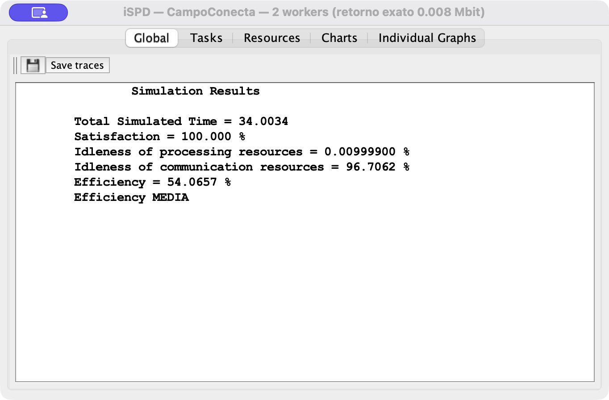
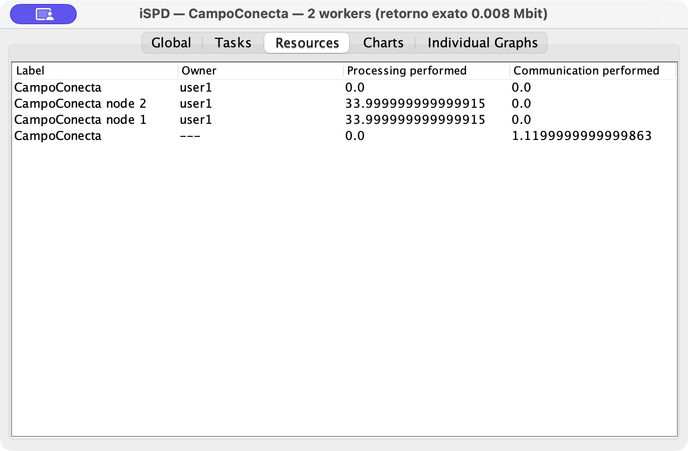
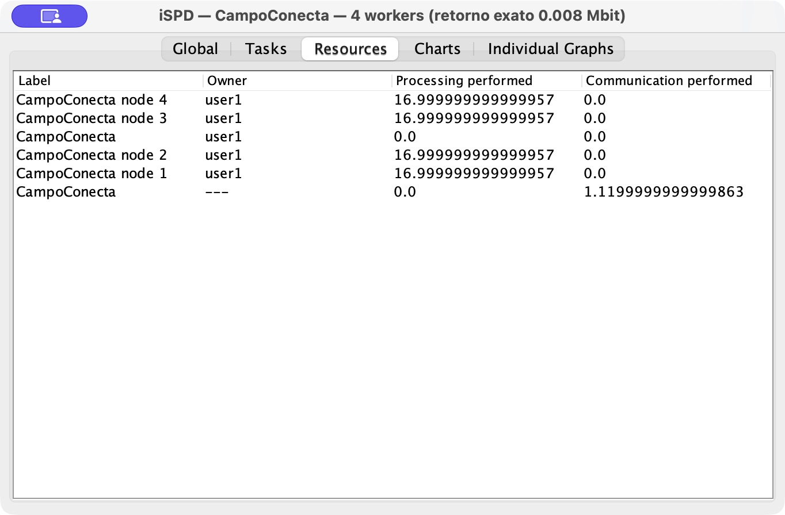

# CampoConecta: comparação de dois cenários no iSPD

**Integrantes:** Pedro Leal Murad (RM 565460), Murilo Benhossi (RM 562358) e Nicolas Lemos Ribeiro (RM 553273).  
**Execução:** 10/11/2026. **Simulador:** iSPD 2.0, JAR oficial do GSPD/UNESP, motor sequencial de eventos discretos. **Ambiente de execução:** Java Temurin 21.0.13, macOS arm64. O tempo do computador que executa o simulador não é o tempo simulado apresentado abaixo.

## 1. Vínculo com o protótipo e hipótese de trabalho

O CampoConecta recebe relatos de pequenos produtores, classifica tipo e urgência e apresenta uma sugestão para conferência humana. A tarefa representada no experimento é uma classificação individual em lote. A pergunta é se dobrar os workers de dois para quatro reduz o tempo necessário para atender a mesma carga.

Segundo a medição fornecida pelo usuário, **o custo de CPU da anonimização e das regras de triagem, sem rede, banco e e-mail, foi de cerca de 51 µs por relato (0,000051 s), medido em máquina de 2 vCPUs (não no equipamento do grupo)**. O valor é a mediana de cinco rodadas sobre 60 textos, em arquitetura x86_64 com Python 3.13; inclui anonimização por expressões regulares/frases-gatilho e classificação de tipo e urgência por regras. Ele substitui a referência anterior de custo por relato e não foi medido novamente nesta execução nem no Mac usado para executar o iSPD. A capacidade de **1.000 MFlops por worker é uma hipótese**: a conversão `0,000051 × 1.000 = 0,051 MFlops por tarefa` seria uma calibração aproximada, não uma medição direta de operações de ponto flutuante.

Os resultados de **34,003400 s e 17,005720 s** foram obtidos anteriormente com **136 MFlops por tarefa**, carga mantida aqui como **cenário sintético intensificado para comparação**. Essa carga não representa o custo real de 51 µs. Recalibrar o modelo para 0,051 MFlops exige novas simulações; os tempos e o ganho atuais não podem ser atribuídos à carga recalibrada. A carga de 500 relatos representa, por hipótese, uma semana de safra de um município, concentrada em um lote disponível no instante zero.

## 2. Modelagem e parâmetros controlados

| Parâmetro | Cenário A | Cenário B | Origem |
|---|---:|---:|---|
| Workers, além de um mestre | 2 | 4 | Variável experimental |
| Capacidade de cada worker e do mestre | 1.000 MFlops | 1.000 MFlops | Hipótese de referência |
| Tarefas disponíveis no instante 0 | 500 | 500 | Hipótese de carga em lote |
| Computação por tarefa no cenário executado | 136 MFlops | 136 MFlops | Carga sintética intensificada; não representa os 51 µs |
| Entrada por tarefa | 0,002 MB = 0,016 Mbit | igual | Hipótese, MB decimal |
| Retorno por tarefa | 0,001 MB = 0,008 Mbit | igual | Hipótese, MB decimal |
| Banda do switch | 100 Mbps | 100 Mbps | Hipótese |
| Latência do switch | 0,001 s = 1 ms | igual | Hipótese |
| Escalonador | RoundRobin | RoundRobin | Controle experimental |
| Falhas, heterogeneidade e carga externa | Ausentes | Ausentes | Simplificação explícita |

Os modelos `.imsx` diferem somente em `nodes="2"` e `nodes="4"`. A leitura efetiva pelo iSPD confirmou que `nodes` cria dois ou quatro workers **mais um mestre**. Os workers têm um processador; RoundRobin distribuiu as tarefas entre eles, sem computação de classificação no mestre.

**Particularidade da versão:** o formulário/XML do gerador de carga não permite informar um retorno separado da entrada. Para representar exatamente os 0,008 Mbit de saída, foi utilizado o pequeno adaptador `ExecutarCenarios.java`, que lê a topologia pelo `IconicoXML`, cria tarefas pelo construtor público `Tarefa(..., entrada, retorno, computacao, chegada)` e chama `SimulacaoSequencial`, `criarRoteamento()` e `simular()` do JAR oficial, sem modificar o motor. Abrir e simular apenas o `.imsx` na GUI usa o retorno padrão dessa versão e, portanto, não reproduz integralmente esta hipótese. As janelas de resultados e a exportação HTML recebem as métricas da execução com o retorno exato.

## 3. Resultados medidos no motor do iSPD — cenário sintético de 136 MFlops

| Indicador | 2 workers | 4 workers |
|---|---:|---:|
| **Total Simulated Time** | **34,003400 s** | **17,005720 s** |
| Tarefas concluídas | 500 | 500 |
| Tarefas por worker | 250; 250 | 125; 125; 125; 125 |
| Processamento por worker | 34.000 MFlops | 17.000 MFlops |
| Segundos ocupados por worker | 34,000000 s | 17,000000 s |
| Uso de cada worker | 99,990001% | 99,966364% |
| Processamento do mestre | 0 MFlops | 0 MFlops |

A contagem de tarefas foi conferida diretamente pelas tarefas concluídas e seu recurso final; também coincide com os MFlops processados divididos por 136. O uso informado é **utilização computacional do worker no intervalo total da execução**: `100 × segundos de processamento / Total Simulated Time`. Não é utilização física da CPU do Mac nem uma porcentagem global que inclua o mestre. A tabela Resources do iSPD 2.0 apresenta “Processing performed” em segundos, devendo-se preservar essa unidade ao interpretá-la.

O script exigido foi executado com os tempos sem arredondamento:

```text
python calcular_ganho.py 34.003399999999914 17.005719999999958
T2 = 34.003 s | T4 = 17.006 s
Redução percentual do tempo: 50.0%
Razão T2/T4 (speedup): 2.00  (ideal com o dobro de workers: 2,00)
Eficiência do paralelismo: 100%
```

Sem o arredondamento de apresentação, a redução é **49,988178%**, a razão T2/T4 é **1,999527** e a eficiência relativa ao dobro de workers é **99,976361%**. O trabalho total é idêntico: 68.000 MFlops e 68 s de processamento somados nos workers. Os JSON, CSV e logs fornecem os valores completos; as capturas devem ser lidas junto dessas tabelas para evitar perda de precisão visual.

## 4. Discussão, gargalos e limites

O ganho ficou próximo do ideal porque as 500 tarefas são independentes, homogêneas e divisíveis igualmente por dois e por quatro. Não houve worker sobrecarregado: cada um recebeu a mesma quantidade de tarefas dentro de seu cenário. A banda é alta em relação às pequenas mensagens e, neste modelo, a computação ocupa quase todo o intervalo; assim, o acréscimo de workers reduziu aproximadamente pela metade a parcela dominante.

O limite computacional ideal seria 34 s com dois workers e 17 s com quatro. O tempo observado excedeu esses limites em 0,003400 s e 0,005720 s, respectivamente. Esses resíduos de eventos de comunicação e coordenação mostram que o paralelismo não eliminou o custo da infraestrutura. A utilização cai ligeiramente no cenário maior porque há mais workers e trocas iniciais/finais para a mesma carga total. Um mestre, rede lenta, mensagens maiores, tarefas desiguais ou uma parte serial do processamento podem limitar o ganho em outras configurações. Os resultados presentes não demonstram que tais gargalos sejam irrelevantes em produção; mostram apenas que não dominaram as hipóteses escolhidas.

Com 0,051 MFlops por tarefa, a computação ideal das 500 tarefas somaria apenas 0,0255 s em um worker de referência; a comunicação e a coordenação poderiam assumir uma participação muito maior. Por isso, o ganho próximo de duas vezes observado com 136 MFlops não deve ser extrapolado para o custo informado de 51 µs sem recalibrar e executar os dois cenários novamente.

A classificação real com Gemini depende de latência da Internet, limites do provedor e tempo de resposta do modelo. Esses fatores não são representados como computação local de 136 MFlops. A espera de CEP, o SQLite, o fluxo de aprovação humana e o envio de e-mail também não foram modelados. Portanto, a simulação sustenta uma conclusão restrita: **dobrar os workers quase duplica a vazão de uma carga computacional homogênea e independente, sob as condições controladas deste experimento**. Não sustenta prometer o mesmo ganho na aplicação completa ou no atendimento ao produtor. Uma próxima etapa seria medir separadamente CPU, rede e banco e simular chegadas ao longo da semana, em vez de concentrá-las no instante zero.

## 5. Reprodução e evidências

1. Obter o JAR oficial em <https://www.dcce.ibilce.unesp.br/spd/downloads/iSPD.jar> (catálogo: <https://www.dcce.ibilce.unesp.br/spd/downloads.php>), conferir `java -jar iSPD.jar -version` e o SHA-256 registrado em `verificacao.json`.
2. Compilar `ExecutarCenarios.java` contra esse JAR e executar cada modelo pelos comandos de `REPRODUZIR.md`. `--gui` mostra as mesmas métricas em Results/Resources para capturas. O adaptador não é uma reimplementação da simulação.
3. Conferir nos CSV a soma de 500 tarefas e nos JSON os tempos; executar `calcular_ganho.py T2 T4`. A comparação automatizada confirmou que os `.imsx` diferem apenas no número de workers.
4. Consultar as exportações HTML oficiais e os logs de execução. Foram capturadas diretamente da janela nativa do iSPD as abas Global (Simulation Results) e Resources de ambos os cenários. Os quatro PNGs estão em resultados/2_workers e resultados/4_workers, com os nomes captura_results_nativa.png e captura_resources_nativa.png. Os tempos exibidos são 34,0034 s e 17,0057 s; coincidem com as métricas completas. As exportações HTML anteriores foram preservadas como evidência adicional. Nenhum resultado foi estimado a partir de uma imagem; as tabelas deste relatório vêm das métricas do motor.

**Fonte técnica:** APIs e DTD contidas no JAR oficial iSPD 2.0; código upstream para referência de conceitos em <https://github.com/gspd-unesp/ispd>. O JAR distribuído pela UNESP é uma versão antiga; não foram misturados resultados de outra versão do simulador.


## Capturas nativas conferidas

| Cenário | Tempo exibido em Results | Tempo completo | Comparação |
|---|---:|---:|---|
| 2 workers | 34,0034 s | 34,003399999999914 s | Igual ao relatório, com arredondamento da interface |
| 4 workers | 17,0057 s | 17,005719999999958 s | Igual ao relatório, com arredondamento da interface |








A inicialização gráfica do adaptador foi corrigida para usar o construtor público completo de JResultados; isso só inicializa as abas nativas e não altera o motor, os parâmetros ou as métricas.
